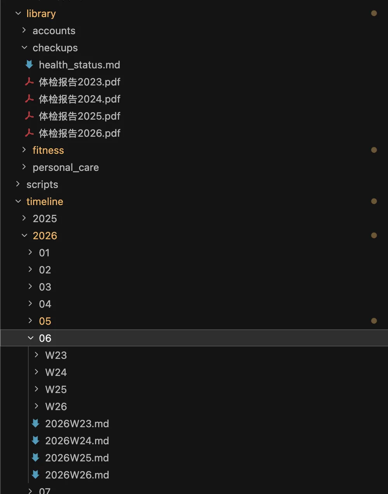
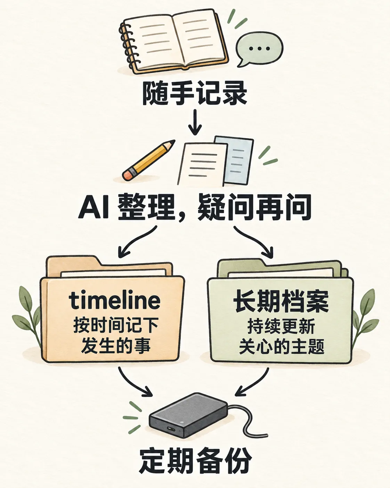

# 看完孙割的访谈，我发现自己的生活已经 AI 化了

最近看孙割和邵艾伦的访谈，他们聊到把饮食、训练这些记录交给 AI 分析，再存成本地 Markdown 文档。以后换一个 AI，读一下文件，就能接着用。

我听着就觉得：这事有点熟悉。

过去半年，我也在一点点这么干。从自动整理工作日志，到体检、健身，再到买东西、安排旅行、周末去哪吃饭，生活里越来越多事情都有了 AI 参与。

最早的想法其实很简单：我想记住自己每天到底干了什么。


## 先从程序员的工作记录开始

我是程序员，工作本来就会留下不少痕迹。Git 里有代码改动，和 AI 的对话 session 里有讨论、尝试，也有走不通的路。

现在，我会自动收集 Git 记录和对话 session，让 AI 整理成工作日志，再补上这些数据里没有的背景和感受。当天做了什么、为什么这么做，就能一起留下来。

每天的记录往上汇成周总结，再汇成季度复盘。这样既能查某一天的细节，也能回头看一段时间主要在忙什么。

这些记录也会慢慢积累成自己的经历库：项目做了什么、我负责哪部分、解决了什么问题、收到哪些反馈。做阶段 review 时，让 AI 帮我梳理重点和不足；更新简历、准备面试时，再按岗位挑选相关经历，整理成能讲清楚的项目案例。每个表述背后，都能找到具体的事情。

这部分自动化比较适合程序员，因为数据本来就在那里。后来我又把监控接了进来，记录的范围也逐渐扩展到了生活。

生活里的很多事，直接说给 AI 听就行。

## 健康，放在一起才能持续跟进

拿健身来说，使用时只需要记下当天练了什么、重量和次数，以及自己的感受，直接发给 AI。它负责整理进训练流水，需要回顾时，再结合之前的记录看训练频率、动作安排和表现变化。

体检也是类似的做法。历年的原始报告保留下来，同时维护一份当前的健康档案。拿到新报告，就可以对照之前的情况整理变化，留下需要继续关注的事项。

补剂、护肤这些日常护理，则集中放在一份文档里。现在用什么、做过哪些调整、实际感觉如何，都有地方可查。

我比较喜欢这个分工：**我负责提供真实情况，AI 帮我整理记录、回顾变化，再一起讨论下一步。**

## 生活里，买什么、去哪儿都能聊

买东西时，可以结合我已经有什么、预算多少、准备怎么用，比较不同选项。安排旅行时，就带上我喜欢的风景、能接受的强度和已有装备，再讨论目的地与行程。

我还接了一些地图 API，让 AI 能查地点和路线。这样连“周末去哪吃饭”也可以聊：先说想吃什么、愿意跑多远，再结合地点和交通，把吃饭、散步或者附近想去的地方一起安排。

这些场景用到的东西其实很相通：**过去的记录提供我的偏好，工具补充这次需要的信息，AI 帮忙比较和安排。**

用完、吃完、玩完，再随手补一句感受，留作下次选择的参考。

## 这些事情，底下用的是同一套系统

这些用法积累下来，需要一套固定的整理方式：新内容放哪里，哪些资料要更新，以后怎么找。

里面有不少工作和个人信息，完整资料不方便公开。目录结构和维护思路可以分享，下面是一个简化示意，文件名只用来说明放法：

```text
个人资料/
├── README.md
├── library/
│   ├── checkups/
│   │   ├── health_status.md
│   │   └── 体检报告.pdf
│   └── fitness/
│       ├── fitness.md
│       └── training_log.md
├── timeline/
│   └── 2026/
│       ├── 2026Q2.md
│       └── 06/
│           ├── 2026W23.md
│           └── W23/
│               ├── 20260601.md
│               └── 出游计划.20260606.md
└── scripts/
```

`README` 是入口，告诉我和 AI 去哪里找资料；`scripts` 放自动采集、备份这些脚本。记录主要分成 `timeline` 和 `library` 两部分。

**`timeline` 管“当时发生了什么”，`library` 管“这个主题现在是什么情况”。**

日常日志、一次讨论、一份旅行计划，按发生时间留在 timeline，月份下面再按周归拢，方便回顾一周的进展。健康档案、训练记录这类要持续跟进的内容，则放进 library。

有了新变化，就更新对应的长期资料；重要的讨论和决定，另外留一份带日期的记录，两边互相链接。这样能快速了解现状，也能回头找到当时的依据。



*我现在使用的部分目录。原始体检报告和整理后的健康档案放在一起，日常记录则按时间保存。*

重要的主题，还可以单独留一组资料、单开讨论。**比如理财，我会把当时为什么这么想也记下来。** 看到了什么信息，考虑过哪些选择，为什么做这个决定，再和实际操作放在一起。复盘时，让 AI 帮我对照判断依据有没有变化、计划有没有执行、结果和预期差在哪里，再根据新信息更新判断。

我也会给 AI 一些维护约定：先读相关资料，按规则归档和更新，实际发生的事和建议分开写。缺的信息再问我，重要结果由我确认。

大部分整理后的内容都是 Markdown，也就是普通的纯文本。目录、正文和链接都能直接读，自己修改也方便。以后换工具，相关资料和维护约定可以一起带过去。



最后是 backup。整理后的文档要备份，原始报告、附件也一起保留，方便以后重新核对。这些都是自己的经历和判断，丢了挺可惜。

## 半年下来，事情能接着聊了

能持续用下来，对我来说很重要的一点是记录负担小：现成的数据自动收集，生活里的事情随手补充，整理交给 AI。

如果想试试，我觉得可以从一件自己本来就在做的事开始：记一次训练，或者把这周做过的工作整理下来。

一开始不用太追求系统的完备性。我自己在记录过程中，就重构过好几次目录结构，也调整过好几次记录方式。**先把信息留下来。** 等内容多了，哪些经常要查、哪些值得单独跟进、哪里放着不顺手，自然就会清楚，组织方式也可以跟着改。

最早，我只是想把工作记下来，方便整理简历、写 OKR。现在回头看，AI 已经参与到我生活里的各种决定，而且能结合我的情况给出意见。我已经从中受益，也越来越觉得，这些一点点积累下来的个人信息很宝贵。**这份关于我自己的长期记录，没有哪个 AI 平台能凭空提供。**
