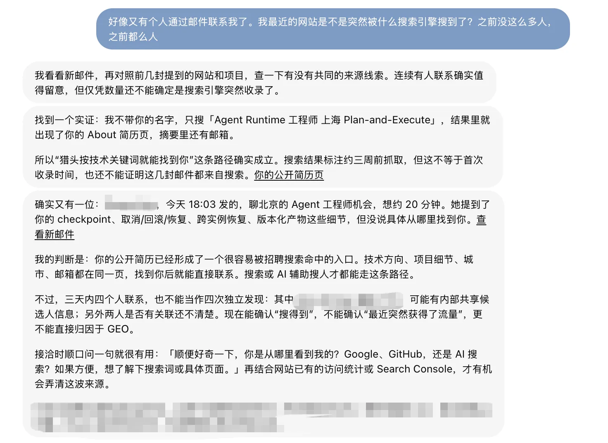
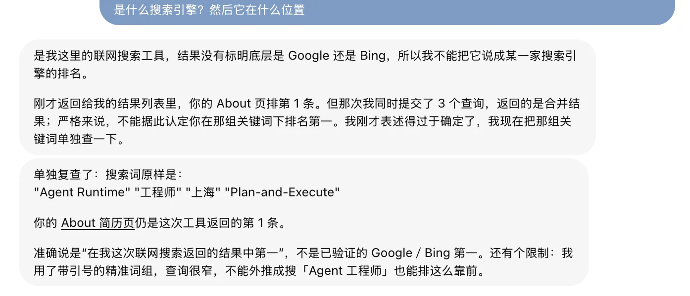

# 我的简历，好像被 GPT 看上了

最近接连收到 4 封猎头邮件，聊的都是 AI Agent 工程方向的机会。我一看这些邮件就像 AI 写的，对我的工作经历总结得很准确，应该是从我的个人网站总结的。并且联系方式非常 traditional 啊——邮件。

我加了其中一位猎头，问了一下，他说是用 Codex 帮他筛选人才简历，然后联系到我的。

我让 Dots 帮忙查了一下（正好前段时间开始玩 Dots，连上 Gmail 分析邮件），还真找到了我的简历页。排名还挺高。我似乎在无意之间做了一些 GEO 😂

算是好消息吧。坚持发声、发小红书、发公众号、维护个人网站，就是想让自己被更多人看到，没想到真被更多人看到了。

「互联网时代，真的要多发声」

顺便我要再优化一下我简历的 GEO，多加点关键词，哈哈哈哈哈哈
