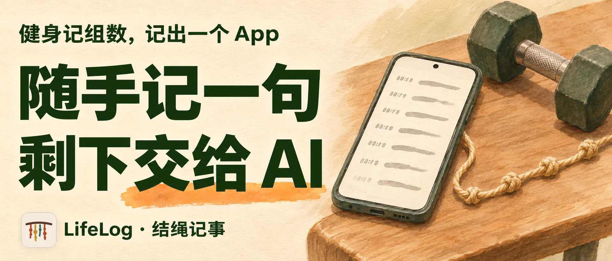
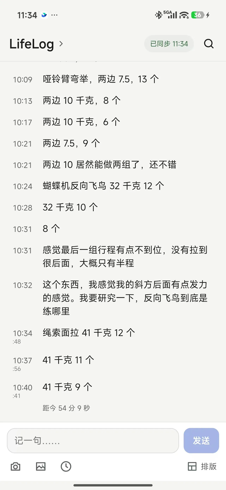
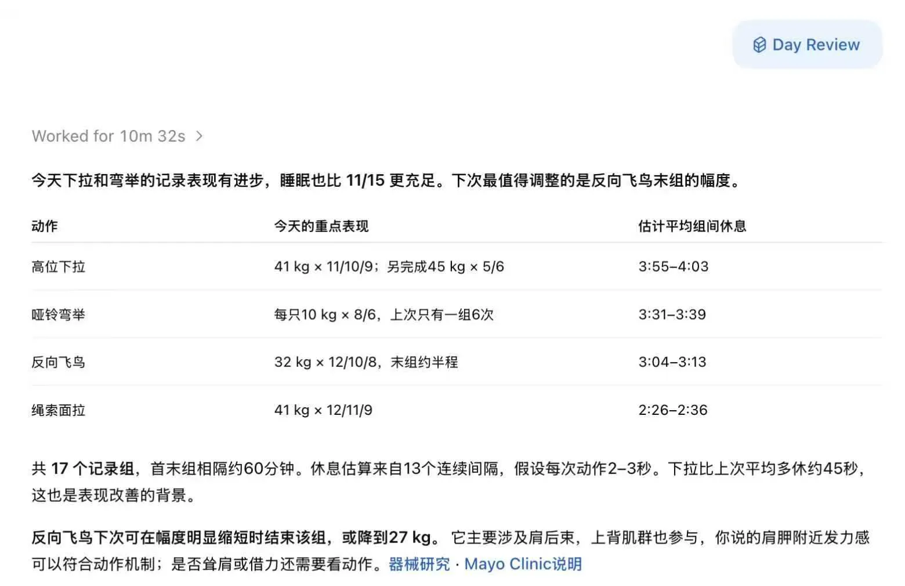

# 为了算清组间休息，我让 AI 写了个 App

我健身一直是用手机记事本记的，练完一组就写一句“卧推 60 公斤 10 个”。用自然语言记其实挺好的，比训练 App 方便多了。那些 App 要自己选动作、选重量再填进去，说实话练着练着去点这些，挺烦的。

但记事本有个问题，它不带时间。

我组间休息一直靠体感，后来发现自己根本把握不好时间。之前还研究过用手环计时、加语音备注，看了一下还挺麻烦的，就算了。

想来想去，我可能只需要一个带时间戳的记事本。

## 自己写一个

先让 AI 搜了一圈有没有现成的，还真有不少，核心功能早就有人做过了。但我还想把数据接进自己的记录系统，让 AI 后面能直接读，想了想还是自己写一个吧。给自己用的安卓 App，应该挺简单吧？

11 月 8 号晚上十点多开始让 Claude Code 写，凌晨一点多第一版就写好了。后面一边用一边改，一周发了 13 个版本（小作坊 App，反正就我自己用）。

它干的事很简单，写一句话，自动带上时间。不分类，也不打标签，想到什么写什么，分类这种事后面交给 AI。数据先存在手机上，再同步到坚果云的 WebDAV，其实就是一个 SQLite 文件加一个照片目录，AI 拿来就能读。

名字就叫 LifeLog。图标用的是“结绳记事”的意思，古人有事要记，就在绳子上打个结，我觉得挺贴切的。

## 记下来以后，谁来看？

我在健康记录的仓库里给 Agent 写了个复盘的 skill。练完在聊天里说一句 `$day-review 今天`，它就会去拉 LifeLog 的记录和照片，再同步一下手环的睡眠、心率和 HRV。然后对照上次同一个动作练了多少，算组间休息，看练完那晚睡得怎么样，再按我记的饮食算算蛋白质，最后写一份当天的复盘存起来。

组间休息是我最开始最想解决的问题。不过我一般是做完一组过 10 到 30 秒才记，有延迟，一开始还担心会不会不准。AI 的解释是，算间隔看的是两次延迟的差，连着算几组，中间的延迟基本就抵消了，首尾那点对平均值只影响几秒。真正不确定的反而是每次动作做多久，所以它按一次 2 到 3 秒给了个范围。

所以我只管随手记，休息了多久它帮我算。

## 举个例子

11 月 18 号练背，这是我练的时候随手记的一段：

*想到什么写什么，感受也直接记进去。弯举那会儿还写了句“两边 10 居然能做两组了，还不错”，哈哈。*

练完说一句 `$day-review`，复盘的训练部分是这样的：

*截了训练部分，后面还有睡眠和饮食。*

有几个地方我觉得挺有用的。下拉这次比上次表现好，它没有直接说我变强了，而是算出我这次平均多休了 45 秒左右，说这也是表现变好的原因之一，挺客观的。反向飞鸟最后一组，我随手写了句“大概只有半程”，它也注意到了，建议下次幅度明显不够的时候就停，或者降到 27 kg。睡眠也对得上，上次练胸那晚只睡了 6 个半小时，HRV 44，后面休息了两天，两晚都睡够了 7 小时，HRV 回到 53、54，差不多是我平时的水平。

再比如 11 月 12 号练腿，做髋内收的时候，36 kg 从 10 个直接掉到 6 个，我当时就在 LifeLog 里写了句“感觉休息时间不长”。复盘的时候它按时间戳一算，掉到 6 个之前只休了 2 分 10 秒左右，后面休了 3 分半，又回到了 7 个。看来我的感觉没错。它建议同重量的组间就固定在 3 分钟左右。同一天的深蹲，50 kg 做了 14、13、13 个，比上次多做了一组，最后一组还有 13 个，它说下次可以试着加点重量。

还有一次我问它，我睡眠一天好一天差，是不是早睡就好了？顺便看看训练对睡眠心率有没有影响。它把 17 个晚上都对了一遍，2 点前睡着的那些晚上，睡眠分中位数是 84，拖到 3 点以后的两晚只有 65，一晚睡了 5 个多小时，一晚不到 5 小时。但同样是 1 点 40 睡着，也出现过 62 分和 81 分。训练和睡眠心率的关系，它就没硬下结论，能对比的 6 次训练，3 次升 3 次降，看不出什么规律。最后建议我先试两周 1 点到 1 点半上床，起床时顺手记个 1 到 5 分的精神状态，再看看。

数据不够它会直接说不够，这点我还挺认可的。

## 用了一周多

LifeLog 里现在有 158 条记录，平均一条才 23 个字。练的那天二三十条，休息日就一两条，整个数据库才 45 KB。

除了健身，平时的小事我也往里记。比如什么时候打完了一个游戏，吃了什么、买了什么，或者突然想到一件事，写一句就行。

这些记录没什么结构，就是一句句零散的话加上时间，不分类，也没有固定格式。以前这种东西我不会记，记了也懒得整理。现在我只管记，整理和分析都留给 Agent，需要的时候让它去读。健身复盘只是其中一种用法，换个场景，让它从同一堆记录里找别的东西就行，能用上的地方其实挺多的。

跟 AI 聊健康的时候，我也不用再从头解释今天干了啥，所有信息都在 LifeLog 里。

功能先就这些，后面有需要再慢慢加吧。
